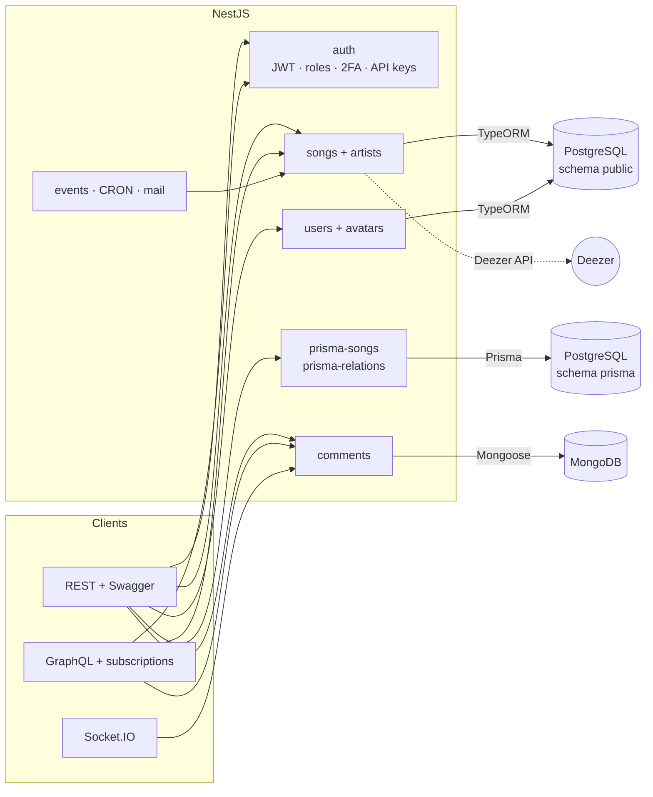

# Music Catalog API

[](https://github.com/sir-collins/n-fundamentals-pro/actions/workflows/ci.yml)


[](./LICENSE)

A NestJS backend for a music catalog: songs, artists, users and comments.
It serves REST, GraphQL and WebSocket clients from the same services.
It stores data in PostgreSQL and MongoDB, and it is covered by unit and
end-to-end tests that run in CI against real databases.

The songs data layer is implemented **twice, in TypeORM and in Prisma**, and
a parity test suite holds both to identical behaviour. The comparison,
including the SQL each ORM actually sends, is written up in
[`docs/04-prisma-vs-typeorm.md`](./docs/04-prisma-vs-typeorm.md).

## Features

- **Songs and artists:** REST and GraphQL with validated, paginated CRUD.
  Artists are many-to-many with songs and are created by name on first use.
- **Authentication:**
  - signup and login issuing JWTs, with `admin` and `user` roles
  - TOTP two-factor login with replay protection
  - API keys sent as `x-api-key`
  - rate limiting: 5 attempts per minute per IP on password and TOTP
    checks (REST and GraphQL), 100 requests per minute elsewhere.
- **Comments in MongoDB:** stored next to the relational data. New comments
  are pushed live over **Socket.IO** and through a **GraphQL subscription**.
- **GraphQL:** code-first. It uses **DataLoader** batching to avoid N+1
  queries, Apollo response caching, and live artist profiles from Deezer's
  public API.
- **Avatar uploads:**
  - PNG, JPEG or WebP up to 2 MB
  - the type is validated from the file's bytes (magic numbers), not the
    client's claimed type
  - stored under server-generated names.
- **Events and jobs:**
  - a `user.created` event sends the welcome email, which is currently
    logged rather than sent
  - a nightly CRON job removes artists that no longer have songs.
- **Prisma counterpart:**
  - `/prisma/songs` mirrors `/songs`
  - one-to-many albums and one-to-one lyrics
  - bulk updates, and an all-or-nothing import in an interactive
    transaction.
- **Operations:**
  - env vars are validated at boot, and both ORMs use committed migrations
  - `/health` checks every datastore
  - helmet security headers, configurable CORS and graceful shutdown
  - structured request logging
  - one global exception filter gives REST and GraphQL a consistent error
    shape, and unexpected errors are logged without leaking internals
  - a multi-stage Docker image with a separate migration step.

## Architecture



Each ORM owns its own Postgres schema (`public` and `prisma`), so neither
treats the other's tables as drift.

## API overview

Full, interactive documentation is at `/api` (Swagger) and `/graphql`.

| Area | Routes |
|---|---|
| Auth | `POST /auth/signup`, `POST /auth/login`, `GET /auth/profile`, `POST /auth/2fa/{generate,turn-on,authenticate}` |
| API keys | `POST /auth/api-keys`, `GET /auth/api-keys`, `GET /auth/api-keys/whoami`, `DELETE /auth/api-keys/:id` |
| Songs (TypeORM) | `GET /songs`, `GET /songs/:id`, `POST /songs`, `PUT /songs/:id`, `DELETE /songs/:id` (writes are admin only) |
| Songs (Prisma) | the same routes under `/prisma/songs`, plus `GET\|PUT /prisma/songs/:id/lyrics`, `POST\|PATCH /prisma/songs/bulk` |
| Artists (Prisma) | `GET /prisma/artists/:id`, `POST /prisma/artists/:id/albums`, `POST /prisma/artists/:id/albums/bulk`, `DELETE /prisma/artists/orphans` |
| Comments | `POST /songs/:songId/comments`, `GET /songs/:songId/comments` (paginated, oldest first), `DELETE /comments/:id` (author or admin) |
| Users | `PUT /users/me/avatar`, `GET /users/:id/avatar` |
| Health | `GET /health` |
| GraphQL | `/graphql`: song queries and admin mutations, artists with Deezer profiles, signup/login/profile, `commentAdded` subscription |

## Tech stack

- **Framework and language:** NestJS 11, TypeScript, Node.js 24.
- **PostgreSQL 16:**
  - **TypeORM** with committed migrations
  - **Prisma 7** through the `pg` driver adapter.
- **MongoDB** with Mongoose.
- **Auth:** Passport (`local`, `jwt`), bcrypt, otplib.
- **API layers:**
  - GraphQL: Apollo, `graphql-ws`, DataLoader
  - WebSockets: Socket.IO
  - REST docs: Swagger / OpenAPI.
- **Background work:** `@nestjs/event-emitter`, `@nestjs/schedule`.
- **Uploads:** multer.
- **Testing:** Jest and supertest.
- **Containers and CI:** a multi-stage Dockerfile, Docker Compose,
  GitHub Actions.

## Getting started

Requires Node 24 and Docker.

```bash
docker compose up -d          # Postgres 16 + MongoDB 7
cp .env.example .env          # defaults match docker-compose.yml
npm install                   # also generates the Prisma client
npm run migration:run         # TypeORM schema
npm run prisma:migrate        # Prisma schema
npm run seed                  # optional: sample songs and artists
npm run start:dev
```

Then open http://localhost:3000/api (Swagger) or http://localhost:3000/graphql.

**Or run everything in Docker** (no local Node needed):

```bash
docker compose --profile app up -d --build
```

This builds the [`Dockerfile`](./Dockerfile), runs a one-off `migrate`
container that applies both migration sets, then starts the API on port
3000. The runtime image holds only production dependencies and the compiled
output, runs as a non-root user, and has a health check on `/health`.

**Trying the API:**
- **Swagger:** the **Authorize** button accepts a JWT from `POST /auth/login`
  (without the `Bearer ` prefix) or an API key from `POST /auth/api-keys`.
- **Demo pages:** `/realtime-comments.html` and
  `/graphql-comment-subscriptions.html` show live comments.
- **REST Client:** [`rest-client.http`](./rest-client.http) has ready-made
  requests for the VS Code REST Client extension.

**Admin access:** new accounts are `user`s. Song writes need an `admin`, so
for local testing promote an account in Postgres:
`UPDATE "user" SET role = 'admin' WHERE email = '…';`

### Configuration

Every variable is validated at boot (`src/config/env.validation.ts`). A
missing or malformed value stops the app with a clear error.

| Variable | Purpose |
|---|---|
| `JWT_SECRET` | Signs access tokens (at least 32 characters) |
| `DB_HOST`, `DB_PORT`, `DB_USERNAME`, `DB_PASSWORD`, `DB_NAME` | Postgres, shared by TypeORM and Prisma ([`prisma.config.ts`](./prisma.config.ts) builds Prisma's URL from them) |
| `MONGO_URI` | MongoDB, for comments |
| `PORT` | HTTP port (default `3000`) |
| `NODE_ENV` | `development`, `production` or `test` |
| `ENABLE_SWAGGER` | Serve Swagger at `/api` (default `true`) |
| `CORS_ORIGIN` | Comma-separated allowed browser origins; unset means same-origin only |
| `DEEZER_API_URL` | Artist profile source (default `https://api.deezer.com`) |
| `UPLOADS_DIR` | Where avatars are written (default `uploads`) |

### Schema changes

| | TypeORM | Prisma |
|---|---|---|
| Generate | `npm run migration:generate -- src/database/migrations/<Name>` | `npx prisma migrate dev --name <name>` |
| Apply | `npm run migration:run` | `npm run prisma:migrate` |

## Testing

```bash
npm test              # unit tests (no databases needed)
npm run test:e2e      # end-to-end, against the Postgres and MongoDB in .env
```

The end-to-end suites boot the whole app against real databases. Each
suite tags its data with a timestamp and deletes it afterwards. The
exception is the orphaned-artist cleanup, which removes *every* orphaned
artist, so run the suites against a development database only.

**Notable suites:**
- **`test/songs-parity.e2e-spec.ts`:** runs the same scenarios against
  `/songs` and `/prisma/songs`.
- **`test/rest.e2e-spec.ts` and `test/graphql.e2e-spec.ts`:** cover both API
  surfaces, including real TOTP codes, API keys and the 500 error path.
- **`test/prisma-transactions.e2e-spec.ts`:** checks rollback against the
  database itself.
- **`test/uploads.e2e-spec.ts`:** includes a text file disguised as a PNG.

**CI** ([`.github/workflows/ci.yml`](./.github/workflows/ci.yml)) has three
jobs:
- **Checks:** lint, formatting, type-checking, the build and the unit tests.
- **End-to-end:** both migration sets and the full suite, against Postgres
  and MongoDB service containers.
- **Docker:** builds the images, applies the migrations from the `migrate`
  image to empty databases, then starts the API image and waits for
  `/health` to pass.

### Coverage

Measured on 2026-11-24 with unit and end-to-end runs merged:

| Lines | Statements | Functions | Branches |
|---|---|---|---|
| 98.6% | 98.6% | 97.4% | 81.2% |

The unit tests alone cover 76% of lines. Most of the gap is wiring that only
runs when the whole app boots, which is what the end-to-end suites do.
Excluded from the count, as setup rather than logic: `main.ts`, the
`*.module.ts` files, the generated Prisma client and `src/database`
(migrations, seed, CLI data source).

```bash
npm run test:cov        # unit coverage    -> coverage/unit
npm run test:e2e:cov    # E2E coverage     -> coverage/e2e
npm run coverage:merge  # combined summary -> coverage/merged (HTML report)
```

## Deployment and known limits

[`railway.json`](./railway.json) runs both migration sets and then starts the
production build, and the [`Dockerfile`](./Dockerfile) runs anywhere that
takes a container. The Railway deployment is paused and not planned to
return, so there's no live demo. These are deliberate limits of this
project, not unfinished work:

- **Avatars are stored on local disk.** That's fine for one long-lived
  server or a Docker volume. A platform that wipes the disk on deploy would
  need object storage instead.
- **The welcome email is logged, not sent.** It runs through an event
  listener, so a real mail service would only replace `MailService`.
- **Rate limits are in memory and per process.** Several instances behind a
  load balancer would need a shared store such as Redis. Behind a proxy, the
  app would also need Express's `trust proxy` setting so it sees real
  client IPs.
- **GraphQL subscriptions use an in-memory PubSub**, so they reach clients
  connected to the same process only.

## How it was built

This started as a project-based path through freeCodeCamp's
["Learn NestJS"](https://www.freecodecamp.org/) course by Haider Malik and
grew well beyond it over 10 projects. The roadmap, a progress log and a
build journal recording each decision and what went wrong are in
[`docs/learning/`](./docs/learning/README.md).

## License

[MIT](./LICENSE)
